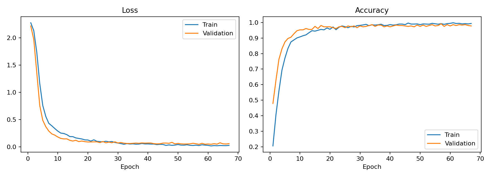
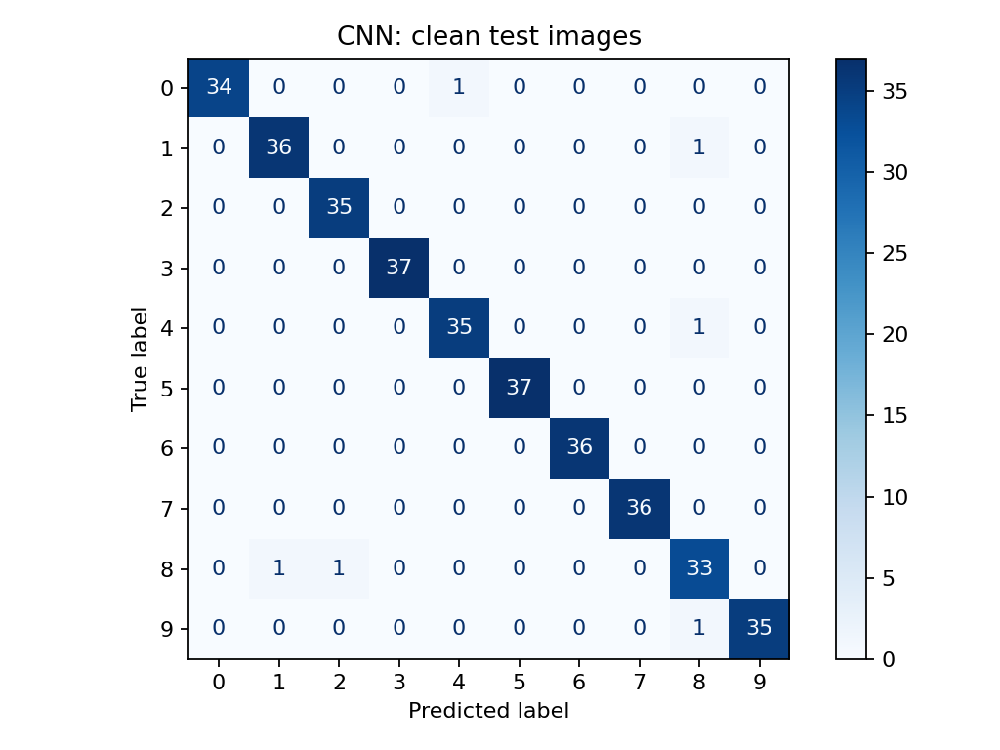
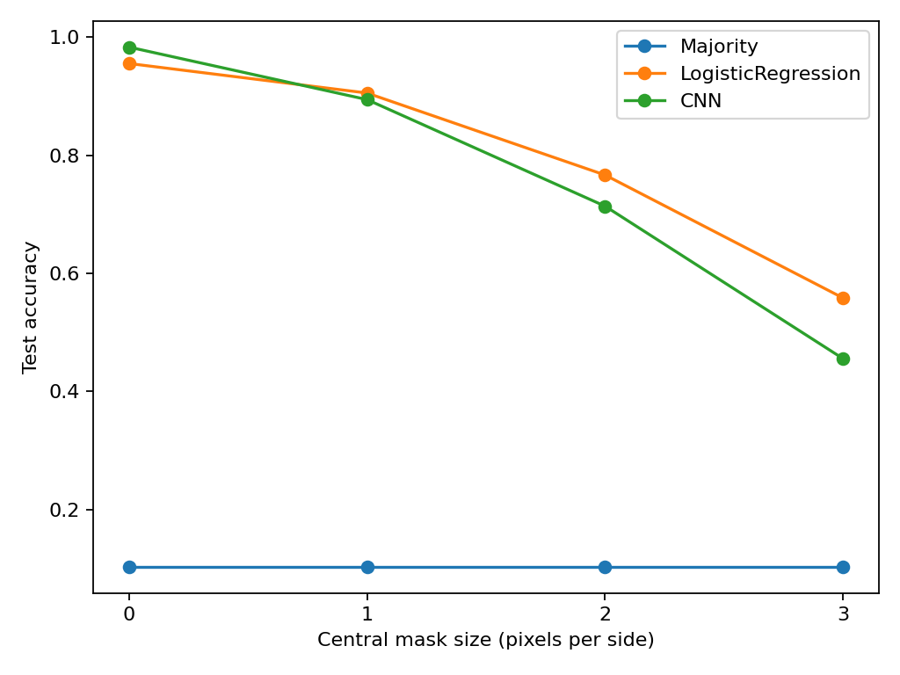

# Missing Digit CNN

นส. นฎา พจนาพิมล 68070272

## ลิงก์ Demo Colab : 
https://colab.research.google.com/drive/1m8ypRXumSoxZf3y46_aSXiZILbFWZlwl

## วัตถุประสงค์
-ต้องการศึกษาว่า CNN สามารถอ่านเลขลายมือ 0–9 ได้ดีแค่ไหนและเมื่อภาพถูกบังบางส่วนโมเดลจะยังอ่านได้ถูกต้องหรือไม่
โดยใช้ชุดข้อมูล Digits จาก scikit-learn ซึ่งมีภาพขนาด 8×8 พิกเซล จำนวน 1,797 ภาพ แบ่งเป็นชุดฝึก ชุด validation และชุดทดสอบในสัดส่วนประมาณ 60:20:20 โดยรักษาสัดส่วนของเลขแต่ละคลาสให้ใกล้เคียงกัน
-โมเดลจะสร้างและฝึกเองจากน้ำหนักเริ่มต้นแบบสุ่มโดยใช้ Cross-entropy เป็นฟังก์ชัน loss และ AdamW เป็น optimizer พร้อมใช้ Dropout, weight decay และ early stopping เพื่อลดปัญหา overfitting จากนั้นประเมินผลด้วย Accuracy และ Macro-F1 เทียบกับวิธีทำนายคลาสที่พบบ่อยที่สุดและ Logistic Regression ส่วนการทดลองภาพถูกบังจะบังบริเวณกึ่งกลางภาพด้วยขนาดที่กำหนดไว้ก่อนทดลอง แล้วดูว่าผลทำนายเปลี่ยนไปอย่างไร รวมถึงวิเคราะห์ confusion matrix และตัวอย่างที่โมเดลทำนายผิด

## ข้อมูลและวิธีแบ่ง
- scikit-learn load_digits(): 1,797 ภาพ ขนาด 8x8 จำนวน 10 คลาส
- https://scikit-learn.org/stable/modules/generated/sklearn.datasets.load_digits.html
- ต้นทาง UCI: https://archive.ics.uci.edu/dataset/80/optical+recognition+of+handwritten+digits
- สำเนา sklearn เป็น original UCI test subset; งานนี้แบ่งใหม่ภายในสำเนานี้ ไม่ใช่ official UCI split
- Train **1,078** / validation **359** / test **360**, stratified, seed42
- ใช้ test_size=0.4 แล้วแบ่งส่วนที่เหลือ test_size=0.5 จึงได้จำนวนดังกล่าวจากการปัดเศษ

## วิธีติดตั้งและทำซ้ำ
รันจากโฟลเดอร์ที่มี README นี้ ใช้ Python และเวอร์ชันตาม results/environment.json
ติดตั้ง dependencies ตาม requirements.txt 

```bash
python -m pip install -r requirements.txt
```


### ประเมิน checkpoint ที่ฝึกไว้แล้ว

```bash
python evaluate.py --results results --output evaluation_recheck.csv
```


ใช้ split และ baseline ของรอบเดิม ไม่แก้ results/metrics.csv โหลดเฉพาะ joblib
ที่เชื่อถือได้ของโครงงานนี้ เพราะรูปแบบ pickle สามารถรันโค้ดได้

### เทรนใหม่เพื่อทำซ้ำ
รันคำสั่งนี้เพื่อเทรนโมเดล:
```bash
python train.py --config config.json --out results_reproduced
```
รอให้เทรนเสร็จ แล้วประเมินด้วยคำสั่งนี้:
```bash
python evaluate.py --results results_reproduced --output evaluation_reproduced.csv
```
### Demo โดยไม่เทรนใหม่
แสดงตัวอย่างที่โมเดลทำนายถูก:
```bash
python demo.py --example success --output success.png
```
แสดงตัวอย่างที่โมเดลทำนายผิด:
```bash
python demo.py --example failure --output failure.png
```
ทดลองบังกลางภาพขนาด 2×2 พิกเซล:
```bash
python demo.py --index 0 --mask-size 2 --output custom.png
```

## Architecture และ hyperparameters

| ชั้น | Output ต่อภาพ |
|---|---|
| Input | 1x8x8 |
| Conv3x3 padding1 + ReLU | 16x8x8 |
| Conv3x3 padding1 + ReLU | 32x8x8 |
| MaxPool2 + Flatten | 512 |
| Linear + ReLU + Dropout | 64 |
| Linear | 10 logits |

38,282 parameters; loss=CrossEntropyLoss บน logits; optimizer=AdamW;
learning rate0.001; weight decay0.0001; dropout0.3; batch64;
สูงสุด80epoch; early stopping patience10; seed42
เลือก checkpoint จาก validation loss ต่ำสุด ไม่ใช้ test
รอบที่แนบฝึก67epoch เลือกepoch57 ใช้CPU ตาม environment.json
training metric วัดระหว่างอัปเดตและเปิด dropout ส่วน validation ปิด dropout

## Evaluation และผลจริง
Primary metric: clean test accuracy; secondary: Macro-F1
Baseline ใช้ train เดียวกัน: majority predictor และ Logistic Regression C1.0 max_iter3000
Robustness: บังกลางภาพด้วยสีดำ ขนาด0,1,2,3 โดย start=(8-size)//2
ตั้งเงื่อนไขไว้ล่วงหน้า ทุกขนาดใช้ test360ภาพเดิม ไม่ใช่ตัวอย่างอิสระเพิ่ม
ไม่มีการฝึกพร้อม augmentation ในรอบนี้

| Model | Mask side | Accuracy | Macro-F1 |
|---|---:|---:|---:|
| Majority | 0 | 0.1028 | 0.0186 |
| LogisticRegression | 0 | 0.9556 | 0.9555 |
| CNN | 0 | 0.9833 | 0.9832 |
| Majority | 1 | 0.1028 | 0.0186 |
| LogisticRegression | 1 | 0.9056 | 0.9026 |
| CNN | 1 | 0.8944 | 0.8916 |
| Majority | 2 | 0.1028 | 0.0186 |
| LogisticRegression | 2 | 0.7667 | 0.7335 |
| CNN | 2 | 0.7139 | 0.6535 |
| Majority | 3 | 0.1028 | 0.0186 |
| LogisticRegression | 3 | 0.5583 | 0.4769 |
| CNN | 3 | 0.4556 | 0.3866 |

CNN clean accuracy=98.33% (354/360) เทียบกับ Logistic Regression=95.56%
เมื่อบัง3x3 CNN เหลือ45.56% ขณะที่ Logistic Regression=55.83%
จึงสรุปได้เฉพาะในรอบนี้ว่า clean accuracy ที่สูงกว่าไม่ได้แปลว่าทนต่อการบังภาพได้ดีกว่า





## Failure case
CNN มีข้อผิดพลาดบนภาพปกติ6ภาพ ตัวแรกในลำดับคำทำนายที่บันทึกคือ dataset index677
label9 แต่ทำนาย8 แม้ไม่บังภาพ ดูรูปใน results/failure_example.png
ภาพความละเอียดต่ำอาจทำให้รูปทรงกำกวม แต่การดูภาพไม่พิสูจน์กลไกภายในของ CNN
เดโมจะแสดง label/prediction จริง ไม่แก้ label

