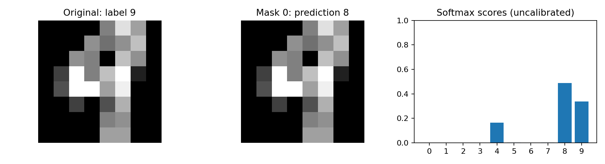

# Missing Digit CNN

นส. นฎา พจนาพิมล 68070272

## Demo Colab
https://colab.research.google.com/drive/1m8ypRXumSoxZf3y46_aSXiZILbFWZlwl

## วัตถุประสงค์
สร้างและฝึก CNN เพื่อจำแนกเลขลายมือ 0–9 แล้วศึกษาว่าการบังกลางภาพส่งผลต่อความแม่นยำอย่างไร โดยเปรียบเทียบกับ Majority predictor และ Logistic Regression พร้อมวิเคราะห์ตัวอย่างที่โมเดลทำนายผิด

## ข้อมูลและวิธีแบ่ง
ใช้ชุดข้อมูล Digits จาก scikit-learn จำนวน 1,797 ภาพ ขนาด 8×8 พิกเซล จำนวน 10 คลาส ปรับค่าพิกเซลให้อยู่ในช่วง 0–1 โดยหารด้วย 16

- [ข้อมูลจาก scikit-learn](https://scikit-learn.org/stable/modules/generated/sklearn.datasets.load_digits.html)
- [ข้อมูลต้นทาง UCI](https://archive.ics.uci.edu/dataset/80/optical+recognition+of+handwritten+digits)

แบ่งแบบ stratified เพื่อรักษาสัดส่วนคลาส โดยใช้ seed 42:

| ชุดข้อมูล | จำนวนภาพ |
|---|---:|
| Train | 1,078 |
| Validation | 359 |
| Test | 360 |

แบ่งด้วย `test_size=0.4` แล้วแบ่งส่วนที่กันไว้ครึ่งหนึ่งด้วย `test_size=0.5` ตรวจว่าไม่มีตัวอย่างซ้ำข้ามชุด และบันทึก indices ไว้ใน `results/split_indices.npz`

สำเนาข้อมูลของ scikit-learn มาจากส่วน test ของ UCI เดิม งานนี้แบ่งชุดใหม่ภายในสำเนานั้น จึงไม่ใช่การประเมินบน official split ดั้งเดิม และไม่ได้แยกข้อมูลตามผู้เขียน

## วิธีติดตั้งและทำซ้ำ
เปิด Terminal ในโฟลเดอร์โปรเจกต์ที่มี README นี้ แล้วติดตั้งไลบรารี:

```bash
python -m pip install -r requirements.txt
```

เวอร์ชัน Python และไลบรารีของรอบเดิมอยู่ใน `results/environment.json`

### ประเมินโมเดลที่ฝึกไว้แล้ว
โหลด checkpoint และประเมินด้วย test ชุดเดิม โดยไม่ต้องเทรนใหม่:
```bash
python evaluate.py --results results --output evaluation_recheck.csv
```
ผลจะบันทึกใน `evaluation_recheck.csv` โดยไม่เขียนทับ `results/metrics.csv`

### เทรนใหม่เพื่อทำซ้ำ
รันคำสั่งแรกแล้วรอให้เทรนเสร็จ ก่อนรันคำสั่งประเมิน:

```bash
python train.py --config config.json --out results_reproduced
```

```bash
python evaluate.py --results results_reproduced --output evaluation_reproduced.csv
```

หากโฟลเดอร์ผลหรือไฟล์ output มีอยู่แล้ว ให้ใช้ชื่อใหม่และแก้คำสั่งให้ตรงกัน ผลอาจต่างเล็กน้อยเมื่อเปลี่ยนเวอร์ชันไลบรารีหรืออุปกรณ์ แม้ใช้ seed เดียวกัน

สำหรับ Colab เปิด `capstone_digits.ipynb` แล้วรันเซลล์จากบนลงล่าง

### เดโมโดยไม่เทรนใหม่
แสดงตัวอย่างที่โมเดลทำนายถูก:
```bash
python demo.py --example success --output success.png
```

แสดงตัวอย่างที่โมเดลทำนายผิด:
```bash
python demo.py --example failure --output failure.png
```

## โมเดลและค่าที่ใช้ฝึก
CNN ฝึกจากน้ำหนักเริ่มต้นแบบสุ่ม ไม่ใช้ pretrained weights มีพารามิเตอร์ทั้งหมด 38,282 ตัว

| ชั้น | Output ต่อภาพ |
|---|---|
| Input | 1×8×8 |
| Conv 3×3, padding 1 + ReLU | 16×8×8 |
| Conv 3×3, padding 1 + ReLU | 32×8×8 |
| MaxPool 2×2 + Flatten | 512 |
| Linear + ReLU + Dropout | 64 |
| Linear | 10 logits |

| รายการ | ค่าที่ใช้ |
|---|---|
| Loss | CrossEntropyLoss บน logits |
| Optimizer | AdamW |
| Learning rate | 0.001 |
| Weight decay | 0.0001 |
| Dropout | 0.3 |
| Batch size | 64 |
| Seed | 42 |
| Epochs สูงสุด | 80 |
| Early-stopping patience | 10 epochs |

เลือก checkpoint จาก validation loss ต่ำสุด ไม่ใช้คะแนน test เลือกโมเดล รอบที่รายงานฝึกบน CPU ทั้งหมด 67 epochs และเลือก checkpoint ที่ epoch 57 ไม่มี data augmentation ระหว่างฝึก

## การประเมินและผลทดลอง
ใช้ Accuracy เป็นตัวชี้วัดหลักและ Macro-F1 เป็นตัวชี้วัดรอง ทุกโมเดลฝึกด้วย train ชุดเดียวกัน โดย Logistic Regression ใช้ `C=1.0` และ `max_iter=3000`

ผลบนภาพ test ปกติ:

| โมเดล | ทำนายถูก | Accuracy | Macro-F1 |
|---|---:|---:|---:|
| Majority predictor | 37/360 | 10.28% | 0.0186 |
| Logistic Regression | 344/360 | 95.56% | 0.9555 |
| CNN | 354/360 | 98.33% | 0.9832 |

ทดลองบังกลางภาพด้วยสีดำขนาด 1×1, 2×2 และ 3×3 พิกเซล โดยใช้ `start=(8-size)//2` ตามเงื่อนไขที่กำหนดไว้ก่อนประเมิน ทุกเงื่อนไขใช้ test 360 ภาพเดิมและไม่ฝึกโมเดลใหม่

เมื่อบังขนาด 3×3 ความแม่นยำของ CNN เหลือ 45.56% ส่วน Logistic Regression ได้ 55.83% แม้ CNN จะอ่านภาพปกติได้แม่นยำกว่า แต่ก็ได้รับผลกระทบจากการบังกลางภาพมากกว่า

ดูผลทุกเงื่อนไขได้ใน `results/metrics.csv` และคำทำนายรายภาพใน `results/predictions.csv`


Train metric ในกราฟวัดระหว่างอัปเดตน้ำหนักและเปิด Dropout ส่วน validation วัดด้วยโมเดลปลาย epoch และปิด Dropout

## Failure case
CNN ทำนายภาพปกติผิดทั้งหมด 6 ภาพ ตัวอย่างนี้คือภาพหมายเลข 677 ซึ่งเป็นเลข 9 แต่โมเดลทำนายเป็นเลข 8 ทั้งที่ภาพไม่ได้ถูกบัง



ภาพมีขนาดเพียง 8×8 พิกเซล จึงอาจเห็นรายละเอียดที่แยกเลขทั้งสองได้ไม่ชัด อย่างไรก็ตาม การดูภาพเพียงอย่างเดียวยังบอกไม่ได้แน่ชัดว่าโมเดลสับสนเพราะอะไร

## ข้อจำกัด
ใช้ข้อมูลขนาดเล็กและ seed เดียว ทดสอบการบังเฉพาะกลางภาพ และยังไม่ได้ประเมินกับภาพจากกล้องหรือผู้เขียนใหม่ จึงยังไม่สรุปว่าโมเดลพร้อมใช้งานกับภาพจริง
